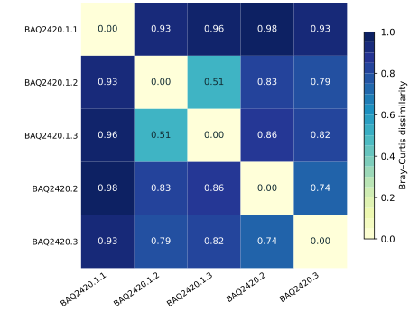

# Ecology Analysis Toolkit

Find an established tool for an ecological question, see what data it expects, and run a small analysis with your own inputs. Curated by Shuai Wu. [中文说明](README.zh-CN.md)

**143 tools and data resources · 6 runnable R/Python workflows.** [Search the online directory](https://azaleawu.github.io/ecology-analysis-toolkit/browse.html), browse the tables below, or download the [offline guide](browse.html). The three source tables link to the software authors, documentation, or data providers.

| Where to start | Questions covered | Examples |
| --- | --- | --- |
| [Microbiome and community analysis · 49](catalog/microbiome.tsv) | How different are my communities? Which taxa are associated with a treatment? How do I describe assembly, networks or functional potential? | phyloseq, mia, vegan, ANCOMBC, ALDEx2, MaAsLin 3, SpiecEasi, iCAMP, PICRUSt2, FUNGuild |
| [Ecological models and prediction · 45](catalog/models.tsv) | Which paths connect climate, soil and respiration? Can a model predict an unsampled site? How do I account for repeated plots or pool study effects? | lavaan, piecewiseSEM, glmmTMB, mgcv, XGBoost, ranger, blockCV, SHAP, metafor |
| [Spatial, field and conservation ecology · 49](catalog/ecology.tsv) | Which environmental values belong to each site? How do I analyze species records, occupancy, traits, range shifts or conservation priorities? | sf, terra, Rasterio, rgbif, unmarked, mFD, biomod2, prioritizr |

## Try it

Run these commands in the extracted or cloned project folder. Browsing and command-line searches require only Python 3. The first analysis uses the included Atacama soil ASV table.

```sh
python toolkit.py find "structural equation"
python toolkit.py find "differential abundance" --subject microbiome
python toolkit.py recipes
python -m pip install numpy scipy matplotlib
python toolkit.py run count-table --out results/atacama
```

The example summarizes **5 libraries, 128 ASVs and 4,261 reads**. Each pairwise distance compares relative abundances after scaling a library to sum to one. The five libraries come from one sampling site. The figure describes differences among libraries at that site. [Data and provenance](data/README.md)



## Six worked analyses

Run `python toolkit.py run NAME --out results/NAME` with a new or empty output folder. Every workflow has a built-in example, accepts user data, and writes files for the next stage of analysis. The count-table example uses public sequence-derived data. The other five use synthetic inputs by default. Install the dependencies for the workflow you choose.

| Name | Your input | What you get | Required packages |
| --- | --- | --- | --- |
| [count-table](recipes/count_table.py) | `--input counts.tsv` with long-format columns `library_id, asv_id, count` | Library size, observed richness, Shannon diversity, pairwise Bray–Curtis distances, and a heatmap for up to 30 libraries | Python · numpy, scipy, matplotlib |
| [community](recipes/community.R) | `--counts counts.tsv --metadata samples.tsv`. Wide count table with `sample_id` first, plus metadata with `sample_id, habitat`. Use independent plots | Diversity by sample, PCoA scores and PDF, habitat PERMANOVA, group dispersion test and R session information | R · vegan |
| [path-analysis](recipes/path_analysis.R) | `--input plots.csv` with `precipitation_mm, temperature_c, soil_moisture_pct, respiration`. One independent plot per row | Direct and indirect paths with confidence intervals, model fit indices, analysis data | R · lavaan |
| [boosted-trees](recipes/boosted_trees.py) | `--input measurements.csv` with `site_id, moisture_pct, temperature_c, carbon_pct, respiration` | XGBoost model, site assignments, held-out predictions, RMSE and a training-mean baseline | Python · numpy, xgboost |
| [spatial](recipes/spatial.py) | `--sites sites.csv --raster soil.tif`. The CSV has `site_id, longitude, latitude` in WGS84. The raster supplies band 1 and its own CRS | One row per site with its raster value or a flag for a missing cell or an out-of-bounds point | Python · numpy, rasterio |
| [meta-analysis](recipes/meta_analysis.py) | `--input effects.csv` with `study_id, effect, variance`. One independent effect per study, on a common scale and in the same direction | Random-effects estimate with a modified Knapp–Hartung interval, study weights, Q, I² and τ² | Python · numpy, scipy, statsmodels |

To run both R workflows, install their packages once with `Rscript -e 'install.packages(c("vegan","lavaan"), repos="https://cloud.r-project.org")'`. For all four Python workflows use `python -m pip install numpy scipy matplotlib rasterio xgboost statsmodels`. R-based commands look up `Rscript` on your PATH. Set `RSCRIPT` to point to a different executable if needed.

## Choosing a method

- **Count tables and metadata.** Start with library depths and sample identifiers. For coverage-standardized diversity, look up iNEXT. The community example tests habitat differences among independent plots. Paired, blocked or repeated sampling needs a permutation design that preserves those dependencies.
- **Environmental gradients.** Choose NMDS for an exploratory ordination. Fit environmental vectors with envfit, use RDA or distance-based RDA for specified predictors, and use varpart to partition variation among predictor tables such as soils, climate and space. [Ordination](https://vegandevs.github.io/vegan/reference/metaMDS.html) · [Environmental vectors](https://vegandevs.github.io/vegan/reference/envfit.html) · [dbRDA](https://vegandevs.github.io/vegan/reference/dbrda.html) · [Variation partitioning](https://vegandevs.github.io/vegan/reference/varpart.html)
- **Community associations.** Choose a differential-abundance method using the study design and the contrast. Network tools estimate statistical associations. Functional annotations inferred from 16S or ITS require coverage and identification information. HUMAnN takes shotgun reads.
- **Mechanism and prediction.** The lavaan example specifies a moisture-mediated pathway before fitting the model. The XGBoost example holds out entire sites to estimate error on new sites. For geographic transfer, use the catalogue to find spatial blocking and model diagnostics.
- **Evidence synthesis.** Pool effect estimates once their scales and contrast directions agree. Repeated outcomes from the same study require a model or variance estimator that accounts for within-study dependence.

## Reuse and attribution

The catalogue records tasks, input requirements, outputs, selection guidance and upstream URLs. The repository contributes the organization, search tools, example workflows and their input/output conventions. When publishing an analysis, cite the packages, databases and primary datasets actually used, and use the upstream authors’ licenses for their work. The six bundled examples have been run on their default inputs.

To extend the directory, add a row with the same seven fields to the relevant TSV, using an official project, registry or maintainer link. Rebuild the offline guide with `python tools/build_guide.py`.
